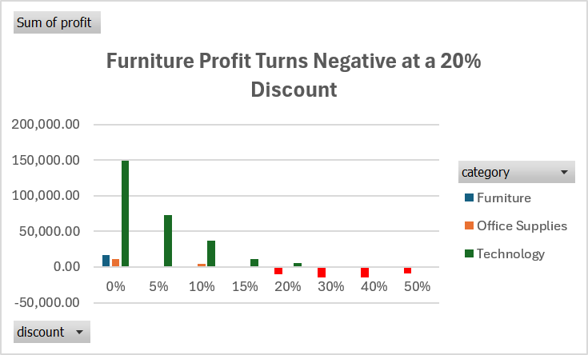
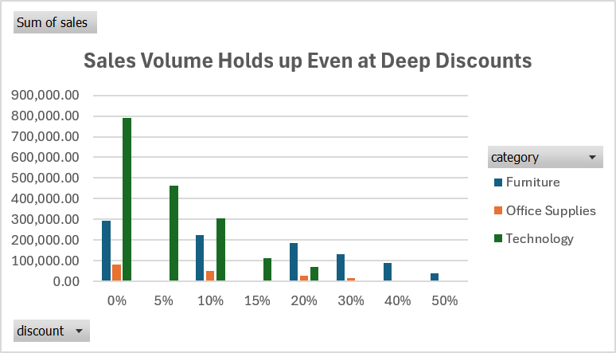
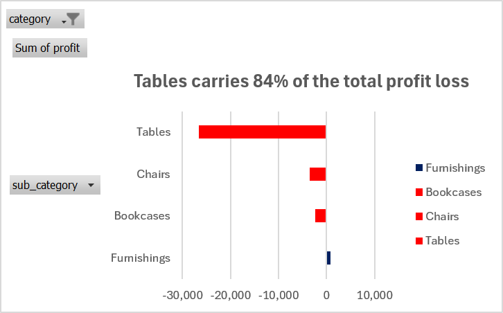
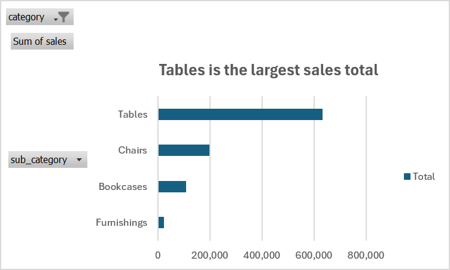
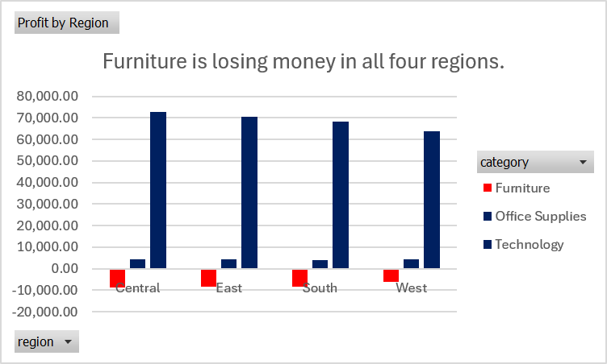
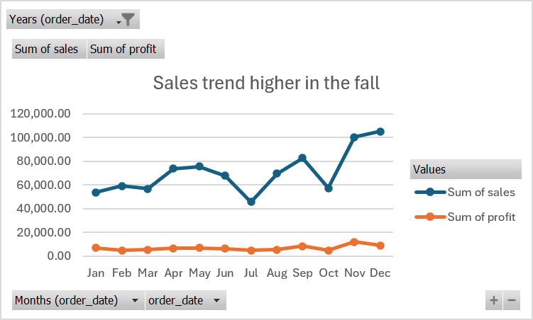

# Superstore Sales: Excel Analysis Report

## Executive Summary

Growth is volume, not margin. Sales grew about 49% in four years while profit margin stayed near 9%, and one product line is quietly eating the profit.

This report re-answers the headline questions from the Superstore SQL analysis in Excel, as an independent cross-check. The workbook (`Superstore-Excel-Analysis.xlsx`) is fed by a live Power Query connection to the same SQL Server database the SQL queries ran against: 6,500 order lines, 3,446 orders, 220 customers, 2021 to 2024. Total sales were $2.88M and total profit was $260K, a 9.0% overall margin, matching the SQL results to the dollar.

### Finding:
Technology earns more profit than the company keeps, and Furniture spends the difference. The fix is a discount policy change, not more volume.

---

## 1. Business Task

**The Business Task:** Understand why profit lags sales growth, and find where the margin is leaking, so leadership can act on the cause instead of chasing more volume. This phase also tests whether a second tool, fed from the same source, reproduces the SQL findings exactly.

**Guiding Questions:**

1. At what discount level does Furniture stop making money?
2. Which sub-category carries the Furniture loss, and is its discount rate the reason?
3. Is the Furniture problem regional, or is it everywhere?
4. How did 2024 perform month to month, and did margin move with sales?

---

## 2. Data Sources

- **Source:** Superstore practice dataset, 6,500 order lines across 3,446 orders and 220 customers, covering 2021 to 2024.
- **Structure:** Order lines with category, subcategory, product, segment, region, sales, profit, quantity, and discount.
- **How Excel received it:** Power Query (Data, Get Data, From SQL Server) against the `superstore` database, table `dbo.superstore_orders`, loaded as a refreshable table. No pasted extract, so the workbook can be refreshed from the source.
- **Note on the data:** This is a public sample used for portfolio analysis, not the canonical 2014 to 2018 Kaggle file, and it contains no employer or customer data.

---

## 3. Excel Methodology

The analysis was run as four PivotTables in one workbook, each with its own PivotChart in a different style, and a one-line takeaway written under each pivot.

- **Pivot A, discount cliff:** discount in rows, category in columns, Sum of profit and Sum of sales. Charted as clustered columns, profit and sales on separate charts so each measure keeps its own scale. Loss bars are filled red, point by point, so below-zero results stand out.
- **Pivot B, where the loss lives:** category filtered to Furniture, sub-category in rows, Sum of profit, Sum of sales, and Average of discount. Charted as horizontal bars, ranked by eye against the zero line.
- **Pivot C, region check:** region in rows, category in columns, Sum of profit. Charted as clustered columns with the Furniture losses in red below the axis.
- **Pivot D, 2024 trend:** order dates grouped by month with the year filtered to 2024, Sum of sales and Sum of profit. Charted as a line chart.
- **Verification:** every pivot grand total was tied back to the SQL results before the takeaway was written (total sales $2,881,924.65, total profit $260,282.21, Furniture profit -$31,701.39, 2024 sales $845,844.15).

---

## Key Insights

### 1. Furniture profit turns negative at a 20% discount

- **Insight:** At full price, Furniture earns $16,477. At a 10% discount it is barely profitable (+$245). At every discount level from 20% up, Furniture loses money (-$10,730 at 20%, -$14,279 at 30%, -$14,770 at 40%, -$8,644 at 50%). Technology stays profitable at every level it is offered.
- **Interpretation:** There is a cliff, and it is at 20%. Below it, discounting Furniture is survivable; at and above it, every sale deepens the loss. The companion chart is the uncomfortable part: Furniture sales volume holds up even at deep discounts, so the demand was never the problem. The discounting is buying volume that loses money.





*Takeaway written under the pivot: "Furniture Sales loses money with every discount starting at 20%, is barely profitable at 10%, and earns 16,477.21 over four years with a 0% discount."*

### 2. Tables carries 84% of the Furniture loss

- **Insight:** Tables lost $26,617 on $633,158 of sales, which is 84% of Furniture's total loss. Chairs lost $3,579 and Bookcases $2,370; Furnishings is the only profitable Furniture sub-category (+$864). All four sub-categories average about the same discount, roughly 19%.
- **Interpretation:** Because the average discount is the same across sub-categories, the discount rate alone does not explain Tables. Tables sells more than the other three combined and still loses the most, which points at Tables pricing underneath the discounts. Fix Tables first.





*Takeaway written under the pivot: "Tables carries 84% of the total profit loss with an average discount of 19%."*

### 3. Furniture is losing money in all four regions

- **Insight:** Every region is profitable overall (Central $68,262, East $66,480, South $63,707, West $61,833), and Furniture is negative in all four (Central -$8,838, East -$8,340, South -$8,377, West -$6,147).
- **Interpretation:** This is not one region's management problem. The same category loses money under four different regional teams, which points at company-wide Furniture pricing and discount policy.



*Takeaway written under the pivot: "Furniture is losing money in all four regions."*

### 4. 2024 sales trend higher in the fall, margins barely move

- **Insight:** 2024 sales totaled $845,844 and profit $79,406. July was the weakest month ($45,548 in sales), December the strongest ($104,922), and November posted the best profit ($11,833). October is an outlier, dropping to $57,262 in sales between September's $82,514 and November's $100,145. December keeps only about an 8.4% margin against November's 11.8%, consistent with heavier year-end discounting.
- **Interpretation:** The two lines on the chart are the whole story: sales swing widely month to month while profit stays in a narrow band. Growth is volume, not margin, in the monthly data just as in the yearly data. The fall discount pattern is the next thing to audit.



*Takeaway written under the pivot: "Sales trend higher in the fall with an outlier in October and a dip in sales in July as profit margins hardly move. May want to look at discount trends in the fall months."*

---

## Cross-Check Against SQL and Tableau

The same dataset was analyzed three ways: 15 T-SQL questions in SQL Server (Project 1), two dashboards in Tableau (Project 2), and this Excel workbook. All three agree on the control totals to the dollar: sales $2,881,925, profit $260,282, Furniture profit -$31,701, Tables profit -$26,617. A finding that survives three independent methods is one leadership can act on.

- SQL queries and leadership report: `Project-1-Superstore-All-Queries.sql`, `Project-1-Leadership-Report.md`
- Tableau dashboards: https://public.tableau.com/app/profile/john.priest6272/viz/SuperstoreDashboardMain/SuperstoreDashboard and https://public.tableau.com/app/profile/john.priest6272/viz/SuperstoreDashboard_17948754317760/SuperstoreDeepDive

---

## Strategic Recommendations

1. **Protect the Technology.** Technology, at a 15.8% margin on 60% of sales, funds the business. Keep its discount discipline as the model.
2. **Re-price or re-discount Tables first**, starting with the Conference Table: cap discounts, set a floor price, or require approval above a discount threshold. A product that only profits at full price should rarely be discounted.
3. **Review Furniture discounting as a policy, not case by case.** The cliff is at 20%: above it, Furniture loses money at every level, in every region, at the same average discount as the sub-categories near break-even.
4. **Keep growing volume, but measure margin with it.** Four years of about 49% sales growth bought only about one point of margin. Report margin next to sales in every monthly review so growth stops masking the leak.

---

## Repository Structure

```
├── Project-1-Leadership-Report.md
├── Excel-Analysis-Report.md
├── Project-1-Superstore-All-Queries.sql
├── Superstore-Excel-Analysis.xlsx
├── README.md
└── charts/
    ├── yearly_trend.png
    ├── share_of_sales.png
    ├── category_margin.png
    ├── monthly_trend.png
    ├── tableau_dashboard_main.png
    ├── tableau_dashboard_deep_dive.png
    ├── excel_discount_profit.png
    ├── excel_discount_sales.png
    ├── excel_furniture_profit.png
    ├── excel_furniture_sales.png
    ├── excel_region_profit.png
    └── excel_2024_trend.png
```

*Methods note: all figures were produced in Excel (Power Query and PivotTables) against the Superstore practice dataset and cross-checked against the SQL control totals listed in the methodology section. Dataset is a public sample used for portfolio analysis; no employer or customer data is included.*
