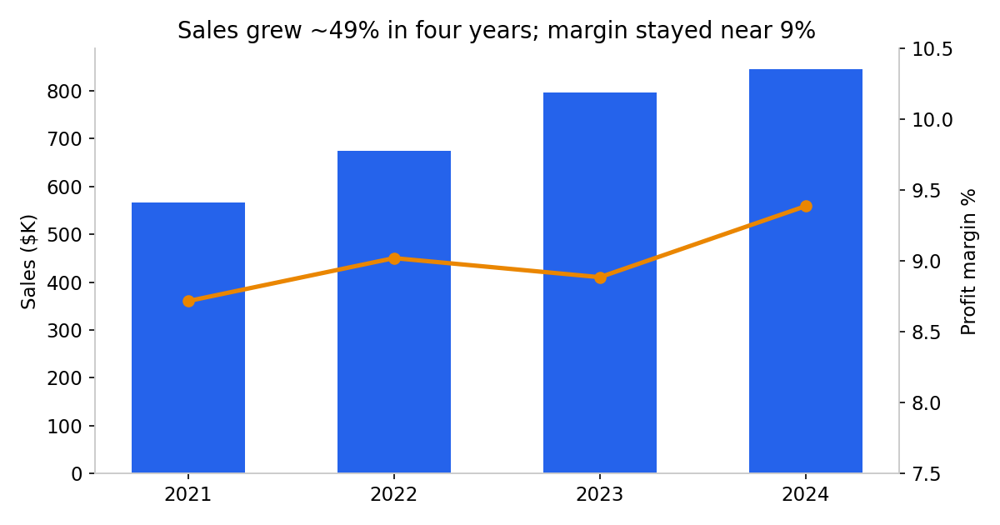
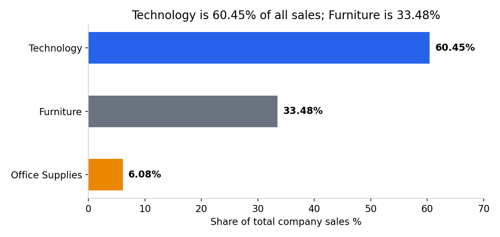
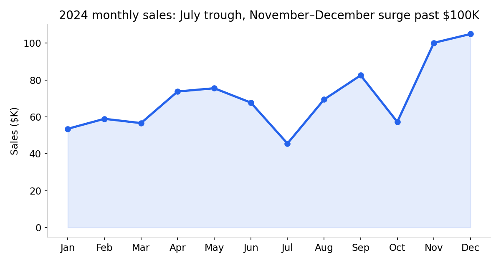

# Superstore Sales: Revenue Trend Report for Leadership

## Executive Summary

Growth is volume, not margin. Sales grew about 49% in four years while profit margin stayed near 9%, and one product line is quietly eating the profit.

This report comes from a 15-question SQL analysis (T-SQL) of the Superstore dataset: 6,500 order lines, 3,446 orders, 220 customers, 2021 to 2024. Total sales were $2.88M and total profit was $260K, a 9.0% overall margin.

The headline finding: Technology earns more profit than the company keeps, and Furniture spends the difference. The fix is a discount policy change, not more volume.

---

## 1. Business Task

**The Business Task:** Understand why profit lags sales growth, and find where the margin is leaking, so leadership can act on the cause instead of chasing more volume.

**Guiding Questions:**

1. Which categories drive sales, and which drive profit?
2. Which products lose money, and is the problem demand or pricing?
3. What role do discounts play in the margin leak?
4. How did 2024 perform month to month?

---

## 2. Data Sources

- **Source:** Superstore practice dataset, 6,500 order lines across 3,446 orders and 220 customers, covering 2021 to 2024.
- **Structure:** Order lines with category, subcategory, product, segment, region, sales, profit, quantity, and discount.
- **Note on the data:** This is a public sample used for portfolio analysis, not the canonical 2014 to 2018 Kaggle file, and it contains no employer or customer data.

---

## 3. SQL Methodology

The analysis was run as 15 questions in T-SQL against the Superstore data in SQL Server, covering totals, category and region breakdowns, segment shares, top products, and discount bands.

- **Totals first:** Company totals were established before any breakdown, so every share and margin ties back to the same sales and profit figures.
- **Share of total:** Category and segment shares were calculated against the full company total, so the shares sum to 100%.
- **Cross-checks:** The 2024 monthly running total ties to the annual sales figure of $845,844, and the category shares sum to 100%.

---

## Key Insights

### 1. Growth is volume, not margin

- **Insight:** Sales rose from $565,913 in 2021 to $845,844 in 2024, about 49% growth, while profit rose from $49,332 to $79,406. Margin barely moved, from 8.7% to 9.4%.
- **Interpretation:** The company is selling more, not selling better. Four years of growth bought only about one point of margin, so volume alone will not fix profitability.



### 2. Technology carries the company, Furniture spends the difference

- **Insight:** Technology is 60.45% of sales and earns $275,334 in profit, more than the whole company keeps. Furniture is 33.48% of sales and loses $31,701. Office Supplies is 6.08% of sales and earns $16,649.

| Category | Sales | Share of sales | Profit | Margin |
|---|---|---|---|---|
| Technology | $1,742,101 | 60.45% | $275,334 | 15.8% |
| Furniture | $964,735 | 33.48% | -$31,701 | -3.29% |
| Office Supplies | $175,088 | 6.08% | $16,649 | 9.51% |

- **Interpretation:** Sales are not profit. Any plan that grows Furniture sales at the current margin grows the loss with it.




### 3. The leak is Tables

- **Insight:** Tables are 65.63% of all Furniture sales ($633,158) and lost $26,617, which is 84% of Furniture's entire loss. The Conference Table alone sold $401,498 and lost $16,973. All four Furniture products in the company's top 10 by sales lose money.
- **Interpretation:** The loss is concentrated, not spread across the category. Fixing Tables fixes most of Furniture.

### 4. Discounting, not demand, is the margin leak

- **Insight:** The discount ranking is the profit ranking, flipped. Furniture averages a 19.2% discount and a negative 3.29% margin. Office Supplies averages 10.1% and earns 9.51%. Technology averages 5.0% and earns 15.8%.

| Category | Average discount | Margin |
|---|---|---|
| Furniture | 19.2% | -3.29% |
| Office Supplies | 10.1% | 9.51% |
| Technology | 5.0% | 15.8% |

The proof case is the Conference Table: at 0% discount it is profitable (+$5,079), and at every discount level above zero it loses money. About 3 of every 4 Conference Table lines were sold at a discount (212 of 285 order lines, 74%).

- **Interpretation:** Furniture's problem is not demand. Furniture sales grew about 51% from 2021 to 2024, and the category lost money every single year (-$6,495, -$8,435, -$8,781, -$7,991). The current discount approval rules are the problem.

### 5. 2024 had a soft middle and a strong finish

- **Insight:** Monthly 2024 sales ran from a July trough of $45,548 to a November to December surge past $100K each month. November posted the largest month-over-month gain of the year (+$42,883). The full-year running total lands on $845,844, which ties back to the annual figure above.
- **Interpretation:** The year-end surge is real, but it does not change the margin story. The same discount leak applies in strong months and weak ones.



---

## Interactive Dashboard and Visualizations

A Tableau KPI dashboard on the same Superstore data is in progress (Project 2). It is not linked here yet. When it ships, it will carry the same verified totals: sales $2,881,925 and profit $260,282.

---

## Strategic Recommendations

1. **Protect the Technology.** Technology, at a 15.8% margin on 60% of sales, funds the business. Keep its discount discipline as the model.
2. **Re-price or re-discount Tables first**, starting with the Conference Table: cap discounts, set a floor price, or require approval above a discount threshold. A product that only profits at full price should rarely be discounted.
3. **Review Furniture discounting as a policy, not case by case.** A 19.2% average discount against a negative margin means the current approval rules are the problem.
4. **Keep growing volume, but measure margin with it.** Four years of about 49% sales growth bought only about one point of margin. Report margin next to sales in every monthly review so growth stops masking the leak.

---

## Repository Structure

```
├── Project-1-Leadership-Report.md
├── Project-1-Superstore-All-Queries.sql
├── README.md
└── charts/
    ├── yearly_trend.png
    ├── share_of_sales.png
    ├── category_margin.png
    └── monthly_2024.png
```

*Methods note: all figures were produced with SQL (T-SQL) against the Superstore practice dataset and cross-checked against control totals (category shares sum to 100%; the 2024 monthly running total ties to the annual sales figure). Dataset is a public sample used for portfolio analysis; no employer or customer data is included.*

