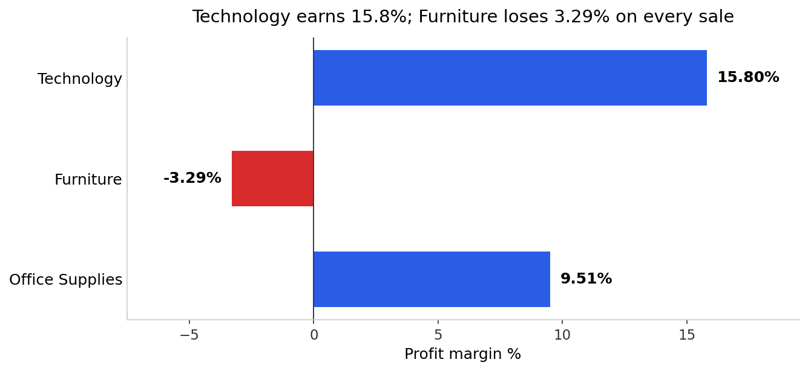

# Superstore Sales: Revenue Trend Report for Leadership

**Growth is volume, not margin.** Sales grew ~49% in four years while profit margin stayed near 9%, and one product line is quietly eating the profit.

Prepared from a 15-question SQL analysis (T-SQL) of the Superstore dataset: 6,500 order lines, 3,446 orders, 220 customers, 2021–2024.

## The business at a glance

- **$2.88M** in sales, **$260K** in profit, a **9.0%** overall margin.
- 2021 to 2024: sales rose from $565,913 to $845,844; profit rose from $49,332 to $79,406.
- Margin barely moved (8.7% to 9.4%). The company is selling more, not selling better.

## Where the money is made, and lost

Technology earns more profit than the company keeps. Furniture spends it.

| Category | Sales | Share of sales | Profit | Margin |
|---|---|---|---|---|
| Technology | $1,742,101 | 60.45% | $275,334 | 15.8% |
| Furniture | $964,735 | 33.48% | −$31,701 | −3.29% |
| Office Supplies | $175,088 | 6.08% | $16,649 | 9.51% |

## The leak: Tables

- Tables is 65.63% of all Furniture sales ($633,158) and lost **−$26,617**, which is **84% of Furniture's entire loss**.
- The Conference Table alone sold $401,498 and lost −$16,973. All four Furniture products in the company's top 10 by sales lose money.
- Furniture's problem is not demand. Furniture sales grew ~51% from 2021 to 2024 and the category lost money every single year (−$6,495, −$8,435, −$8,781, −$7,991).

## Why it loses money: discounting

The discount ranking is the profit ranking, flipped:

| Category | Average discount | Margin |
|---|---|---|
| Furniture | 19.2% | −3.29% |
| Office Supplies | 10.1% | 9.51% |
| Technology | 5.0% | 15.8% |

The proof case is the Conference Table: at 0% discount it is profitable (+$5,079); at every discount level above zero it loses money. About 3 of every 4 Conference Table lines were sold at a discount. Discounting, not demand, is the margin leak.

## 2024 in the year: a soft middle, a strong finish

Monthly 2024 sales ran from a July trough of $45,548 to a November–December surge past $100K each month. November posted the largest month-over-month gain of the year (+$42,883). The full-year running total lands on $845,844, which ties back to the annual figure above.

## Recommendation

Fix the discount policy before chasing more volume.

1. **Protect the engine.** Technology, at a 15.8% margin on 60% of sales, funds the business. Keep its discount discipline as the model.
2. **Re-price or re-discount Tables first**, starting with the Conference Table: cap discounts, set a floor price, or require approval above a discount threshold. A product that only profits at full price should rarely be discounted.
3. **Review Furniture discounting as a policy, not case by case.** A 19.2% average discount against a negative margin means the current approval rules are the problem.
4. **Keep growing volume, but measure margin with it.** Four years of ~49% sales growth bought only ~1 point of margin. Report margin next to sales in every monthly review so growth stops masking the leak.

*Methods note: all figures were produced with SQL (T-SQL) against the Superstore practice dataset and cross-checked against control totals (category shares sum to 100%; the 2024 monthly running total ties to the annual sales figure). Dataset is a public sample used for portfolio analysis; no employer or customer data is included.*
